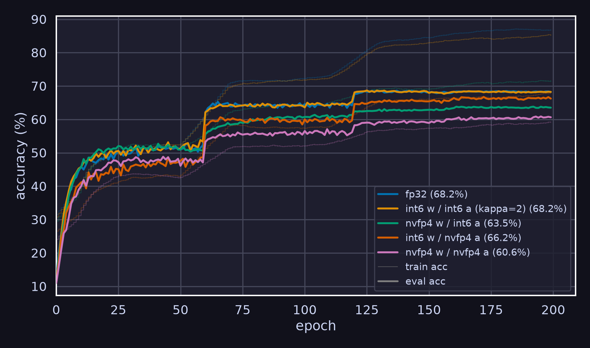
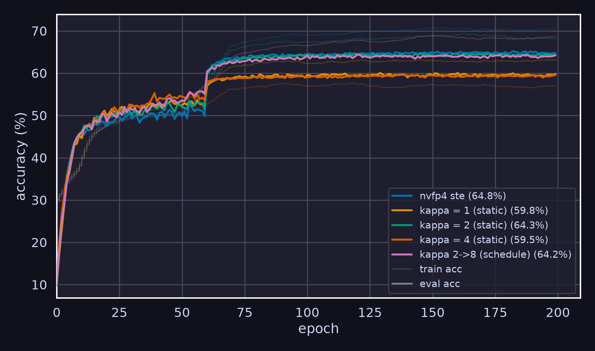

# Cascaded CDL

[Coded Deep Learning: Framework and Algorithm](https://arxiv.org/abs/2501.09849) - C2

## Challenges

### Overhead

The quantizers involve the following main operations.

- Top-K selection: If the quantization alphabet is uniform, or companding is applied for a non-uniform alphabet, this operation is negligible. Note that we must apply it before computing $P_\alpha(\cdot|\theta)$, the CPMF. If top-k selection is enabled, we also need to store at least the starting index of each top-k window, which occupies $\theta$ times 8 bytes. Torch requires indices to be `int64`.
- $-\alpha \cdot ([\theta]_{2^b} - \hat{\mathcal{A}})^2$: Broadcasting $\theta$ leads to significant memory overhead because the resulting tensor is $K$ times larger than $\theta$, where $K$ depends on the top-k selection configuration.
- $\sigma(\cdot)$: The number of softmax operations required grows **linearly** as $\theta$ gets larger.
- $Q_p(\theta)$ and $Q_d(\theta)$: Sampling causes minor overhead but is not the bottleneck at the moment.
- $\mathsf{H}(\omega)$: The entropy term computation is extremely expensive. Because of the previous top-k selection, we need to perform scatter-add, which is not memory friendly.

In short, the minimum cost consists of $K$ times the peak memory usage and a linearly growing number of softmax operations. If quantizers were inserted for every GEMM activation and weight, they would dominate training speed. To minimize the overhead, we need customized kernels.

### Implicit GEMM

**Background information**: A convolution operation can be converted into matrix multiplication by a preprocessing operation called `im2col`. However, this requires materializing a huge buffer. Implicit GEMM is a technique that performs this indexing on the fly.

`F.unfold` returns `[N, C * Kh * Kw, OH * OW]`. After transposing and flattening, we obtain:

- Activation: `[N, C, H, W]` to `X = [N * OH * OW, C * Kh * Kw]`
- Weight: `[Out, In, Kh, Kw]` to `W = [Out, In * Kh * Kw]`

where `In == C` when `groups == 1`, and

- `OH = floor((H + 2*P - D*(Kh-1) - 1) / S) + 1`
- `OW = floor((W + 2*P - D*(Kw-1) - 1) / S) + 1`

Then we can compute `out = X @ W.T` and reshape/permute it back to `[N, Out, OH, OW]`. The simple GEMM is the part we want to accelerate, although it is not the bottleneck given the significant overhead introduced by the quantizers.

**However, FP4/FP8 implicit GEMM does NOT exist.**

This implies two things. First, we have to apply `im2col` manually before quantization and GEMM, which eliminates the memory savings that GEMM could have provided. Second, the quantization semantics are unusual. The same activation value appears in multiple `im2col` rows, so it can receive different quantization codes or scales depending on its patch and output position. Therefore, all `N * OH * OW` rows must share the same scaling factor. In the previously described layout, the tensor is reshaped to `[N * OH * OW, C * Kh * Kw / 16, 16]`, which corresponds to a scale factor of shape `[1, C * Kh * Kw / 16, 1]`.

### Alpha vs. Kappa

The original formula $[P_\alpha(\cdot|\theta)] = \sigma(-\alpha \cdot ([\theta]_{2^b} - \hat{\mathcal{A}})^2)$ used a sharpness factor in the value domain and initialized that factor to $500$ for both activation and weight quantizers. However, gradient explosion occurred in the first step. Therefore, I modified it to $[P_\alpha(\cdot|\theta)] = \sigma(-\kappa \cdot ([\frac{\theta}{q}]_{2^b} - \mathcal{A})^2)$, where $\kappa = \alpha q^2$. Instead of training $\alpha$, we train $\kappa$, which is the sharpness factor in the index domain. This naturally applies to the companded domain.

Previously, I set $\kappa = 2$ and excluded it from the trainable parameters. The quantizers are relatively soft under this setting, so I applied batch normalization re-estimation on 100 batches from the training dataset before evaluation. This successfully reproduced the results presented in the paper. Increasing $\kappa$ sometimes leads to unstable training, but the safety range seems to be larger for a non-uniform quantization alphabet.

## Preliminary NVFP4 Experiments

### Software Simulated on CDL

Following the same setup as in the CDL paper with my $\kappa$ modification, I replace the `int6` quantizer with `nvfp4` without block scalers. Technically, this can be accelerated by hardware, but I did not have time to wire up GEMM last week. The intention is to see whether we need cascaded quantization and which of weight and activation is more sensitive to low-bit quantization.

### Hardware Accelerated Cascaded CDL Weight and STE Activation

Cascaded CDL for activation triples the training time, so I tested the implementation on weights only. The activation is quantized using dynamic quantization proxied by STE, which is the most common approach. The cascaded CDL is per-block quantized, but we can apply per-channel quantization.

