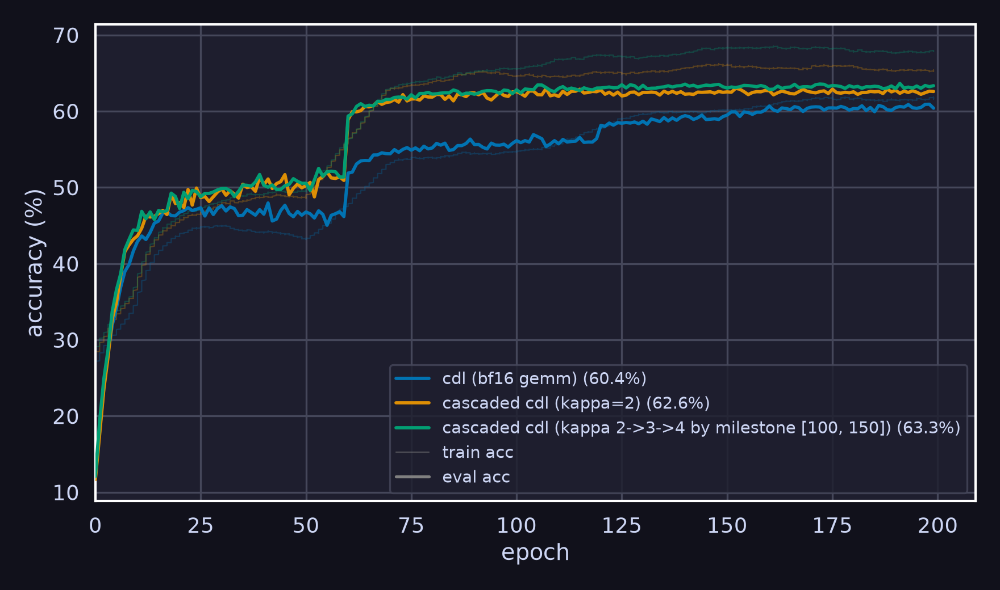

# Faster Cascaded CDL

[Coded Deep Learning: Framework and Algorithm](https://arxiv.org/abs/2501.09849) - C2

## Fused Cascaded CDL NVFP4 GEMM Benchmark

All measurements were run on an RTX 5070 Ti with 16 GB of memory using `torch.compile` with `reduce-overhead` (CUDA Graphs) in training mode. **Bold** indicates the best result, and "-" indicates out of memory. The Triton kernel was written by GLM-5.3-Flash, so there is likely still room for improvement. We compare three implementations.

- `baseline`: standard matrix multiplication in `bf16`, i.e., no quantization
- `src`: naively optimized Cascaded CDL on both activations and weights, using NVFP4 GEMM for the matrix multiplication
- `fused`: equivalent to `src`, but computed by a single fused Triton kernel

**Note**: Entropy computation is excluded; it would likely add around 5% overhead to the fused kernel and more than 100% to the optimized torch implementation.

### Time

Wall-time in ms is the sum of the forward median and the backward median.

| shape (M, K, N)                  | baseline |   src |     fused | fused/baseline | src/baseline |
| -------------------------------- | -------: | ----: | --------: | -------------: | -----------: |
| small (64, 512, 512)             | **0.48** |  0.69 |      0.60 |          1.25x |        1.43x |
| medium (512, 1024, 1024)         | **0.54** |  0.92 |      0.76 |          1.39x |        1.69x |
| large (2048, 2048, 2048)         | **0.81** |  4.45 |      0.96 |          1.18x |        5.48x |
| 7b-attn (4096, 4096, 4096)       |     4.79 | 19.94 |  **3.78** |          0.79x |        4.16x |
| 7b-qkv (4096, 4096, 12288)       |    13.44 |     - |  **8.73** |          0.65x |            - |
| 7b-mlp (4096, 4096, 11008)       |    12.12 |     - |  **7.97** |          0.66x |            - |
| 7b-mlp-s8k (8192, 4096, 11008)   |    24.12 |     - | **13.16** |          0.55x |            - |
| 7b-mlp-s16k (16384, 4096, 11008) |    50.14 |     - | **23.95** |          0.48x |            - |
| 70b-mlp (4096, 8192, 28672)      |    62.28 |     - | **35.64** |          0.57x |            - |
| 70b-mlp-s8k (8192, 8192, 28672)  |   122.69 |     - | **55.70** |          0.45x |            - |

### Peak Memory

Peak memory is what `torch.cuda.max_memory_allocated` reports in MiB.

| shape (M, K, N)                  | baseline |   src |   fused | fused/baseline | src/baseline |
| -------------------------------- | -------: | ----: | ------: | -------------: | -----------: |
| small (64, 512, 512)             |      130 |   230 | **106** |          0.82x |        1.77x |
| medium (512, 1024, 1024)         |      138 |   837 | **117** |          0.85x |        6.06x |
| large (2048, 2048, 2048)         |      184 |  3833 | **145** |          0.79x |       20.83x |
| 7b-attn (4096, 4096, 4096)       |  **352** | 15114 |     461 |          1.31x |       42.94x |
| 7b-qkv (4096, 4096, 12288)       |  **672** |     - |    1011 |          1.50x |            - |
| 7b-mlp (4096, 4096, 11008)       |  **612** |     - |     918 |          1.50x |            - |
| 7b-mlp-s8k (8192, 4096, 11008)   | **1074** |     - |    1543 |          1.44x |            - |
| 7b-mlp-s16k (16384, 4096, 11008) | **1998** |     - |    2793 |          1.40x |            - |
| 70b-mlp (4096, 8192, 28672)      | **1888** |     - |    3863 |          2.05x |            - |
| 70b-mlp-s8k (8192, 8192, 28672)  | **2880** |     - |    4510 |          1.57x |            - |

## Defense Cascaded CDL Design

Last time, I mentioned that vanilla CDL is not sufficient for low-precision training like NVFP4. Here's a direct comparison. Note that the baseline does NVFP4 quantization, but the GEMM is still in `bf16`, which usually gives less than 1% extra precision, yet it's evidently weaker than Cascaded CDL anyway.

However, it does not beat the direct post-training NVFP4-quantized model at 65.3%, and it is not even comparable to activation-aware quantization (AWQ), which can achieve ???%.

### Notations

The original formula $`[P_\alpha(\cdot|\theta)] = \sigma(-\alpha \cdot ([\theta]_{2^b} - \hat{\mathcal{A}})^2)`$ used a sharpness factor in the value domain and initialized that factor to $`500`$ for both activation and weight quantizers. This is equivalent to $`[P_\alpha(\cdot|\theta)] = \sigma(-\kappa \cdot ([\frac{\theta}{q}]_{2^b} - \mathcal{A})^2)`$, where $`\kappa = \alpha q^2`$. Instead of training $`\alpha`$, we train $`\kappa`$, which is the sharpness factor in the index domain. This naturally applies to the indices after companding.

## Next Step: Transformer

We can test our method for pretraining and fine-tuning. The [nanochat](https://github.com/karpathy/nanochat) (~561M) by Andrej Karpathy is a modern implementation of GPT-2; it takes 3 hours of training on 8×H100 at a cost of around $100. Fine-tuning would use LoRA on LLaMA-7B, as presented in the paper. However, NVFP4 GEMM requires Blackwell (sm100+), and as far as I know, none of the Compute Canada clusters (DRAC) have them.
