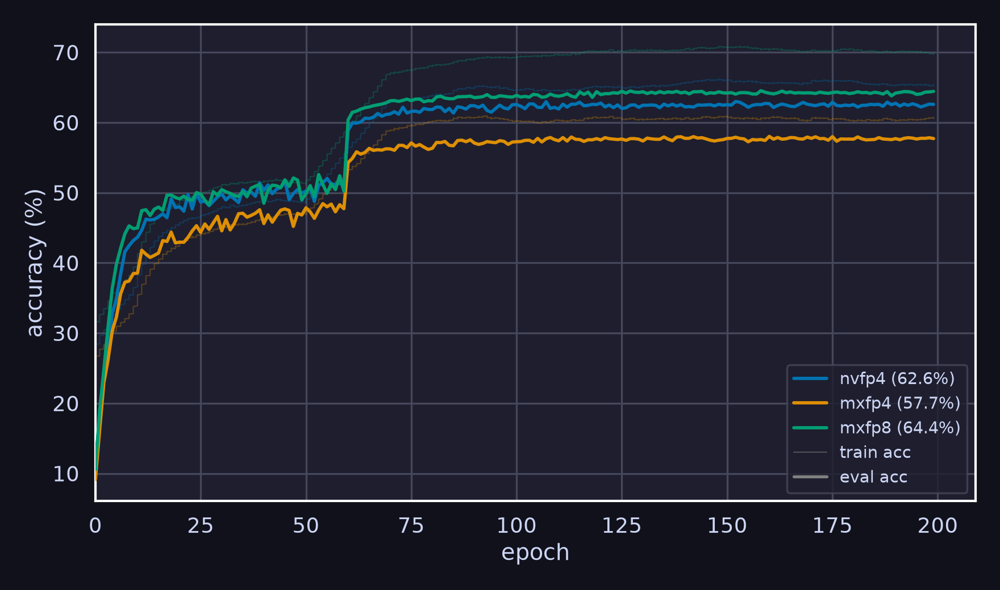

# Faster Cascaded CDL

[Coded Deep Learning: Framework and Algorithm](https://arxiv.org/abs/2501.09849) - C2

## Fused Cascaded CDL GEMM Benchmark

All measurements were run on an RTX 5070 Ti with 16 GB of memory using `torch.compile` with `reduce-overhead` (CUDA Graphs) in training mode. Each cell shows the value with the ratio against the `bf16` baseline, e.g. `0.60 (1.25x)`, and "-" indicates out of memory. The Triton kernel was written by a Flash model, so there is likely still room for improvement. We compare five implementations.

- `bf16 (torch)`: standard matrix multiplication in `bf16`, i.e., no quantization
- `mxfp8 (triton)` / `mxfp4 (triton)`: the fused Triton kernel on MX formats (E4M3 / E2M1 theta with E8M0 block scales, block size 32)
- `nvfp4 (triton)`: the fused Triton kernel on NVFP4 (E2M1 theta, UE4M3 scales, block size 16)
- `nvfp4 (src)`: the decomposed torch implementation of Cascaded CDL quantization feeding the same NVFP4 hardware GEMM for the forward.

Every quantizing arm shares the same specification: weight side top-16 with per-row scales, activation side top-5 with scales shared across rows. Backward always runs in full precision, and entropy computation is excluded throughout.

### Time

Wall-time in ms is the sum of the forward median and the backward median.

| shape (M, K, N)                  | bf16 (torch) | mxfp8 (triton) |   mxfp4 (triton) |    nvfp4 (triton) |   nvfp4 (src) |
| -------------------------------- | -----------: | -------------: | ---------------: | ----------------: | ------------: |
| small (64, 512, 512)             |     **0.47** |   0.76 (1.62x) |     0.63 (1.33x) |      0.64 (1.37x) |  0.71 (1.50x) |
| medium (512, 1024, 1024)         |     **0.54** |   0.95 (1.75x) |     0.80 (1.48x) |      0.71 (1.31x) |  0.85 (1.58x) |
| large (2048, 2048, 2048)         |     **0.78** |   4.50 (5.76x) |     0.86 (1.11x) |      0.87 (1.12x) |  4.06 (5.20x) |
| 7b-attn (4096, 4096, 4096)       |         4.58 |   4.91 (1.07x) |     3.37 (0.73x) |  **3.31 (0.72x)** | 17.20 (3.75x) |
| 7b-qkv (4096, 4096, 12288)       |        13.44 |  13.82 (1.03x) | **8.32 (0.62x)** |      8.44 (0.63x) |             - |
| 7b-mlp-s4k (4096, 4096, 11008)   |        12.11 |  12.04 (0.99x) |     7.65 (0.63x) |  **7.44 (0.61x)** | 35.28 (2.91x) |
| 7b-mlp-s8k (8192, 4096, 11008)   |        24.19 |  19.63 (0.81x) |    12.36 (0.51x) | **12.16 (0.50x)** |             - |
| 7b-mlp-s16k (16384, 4096, 11008) |        48.35 |  34.61 (0.72x) |    22.54 (0.47x) | **22.13 (0.46x)** |             - |
| 70b-mlp (4096, 8192, 28672)      |        62.49 |  60.32 (0.97x) |    36.11 (0.58x) | **34.81 (0.56x)** |             - |
| 70b-mlp-s8k (8192, 8192, 28672)  |       124.23 |  96.87 (0.78x) |    55.98 (0.45x) | **53.80 (0.43x)** |             - |

### Peak Memory

Peak memory in MiB is sampled in-process via `torch.cuda.mem_get_info` throughout the run and reported as the increase over the post-initialization baseline, so it covers the CUDA context, allocator segments and all transient buffers.

| shape (M, K, N)                  | bf16 (torch) |  mxfp8 (triton) |  mxfp4 (triton) |  nvfp4 (triton) |    nvfp4 (src) |
| -------------------------------- | -----------: | --------------: | --------------: | --------------: | -------------: |
| small (64, 512, 512)             |          220 | **188 (0.85x)** | **188 (0.85x)** | **188 (0.85x)** |    318 (1.45x) |
| medium (512, 1024, 1024)         |          260 |     254 (0.98x) |     234 (0.90x) | **232 (0.89x)** |    818 (3.15x) |
| large (2048, 2048, 2048)         |          316 |     236 (0.75x) |     262 (0.83x) | **220 (0.70x)** |   3022 (9.56x) |
| 7b-attn (4096, 4096, 4096)       |      **520** |     582 (1.12x) |     702 (1.35x) |     534 (1.03x) | 12122 (23.31x) |
| 7b-qkv (4096, 4096, 12288)       |      **810** |    1220 (1.51x) |    1756 (2.17x) |    1250 (1.54x) |              - |
| 7b-mlp-s4k (4096, 4096, 11008)   |      **742** |    1120 (1.51x) |    1594 (2.15x) |    1082 (1.46x) | 15009 (20.23x) |
| 7b-mlp-s8k (8192, 4096, 11008)   |     **1288** |    1392 (1.08x) |    1670 (1.30x) |    2012 (1.56x) |              - |
| 7b-mlp-s16k (16384, 4096, 11008) |     **2384** |    2558 (1.07x) |    3016 (1.27x) |    3880 (1.63x) |              - |
| 70b-mlp (4096, 8192, 28672)      |     **2634** |    4414 (1.68x) |    7324 (2.78x) |    4856 (1.84x) |              - |
| 70b-mlp-s8k (8192, 8192, 28672)  |     **3370** |    5178 (1.54x) |    7866 (2.33x) |    5176 (1.54x) |              - |

## Defense Cascaded CDL Design

Last time, I mentioned that vanilla CDL is not sufficient for low-precision training like NVFP4. Here's a direct comparison. Note that the baseline does NVFP4 quantization, but the GEMM is still in `bf16`, which usually gives less than 1% extra precision, yet it's evidently weaker than Cascaded CDL anyway.

However, it does not beat the direct post-training NVFP4-quantized model at 65.3%, and it is not even comparable to Hessian-based error-compensation quantization (GPTQ) at 66.1%. All evaluated end-to-end through the real NVFP4 GEMM. According to LLM's PTQ implementation.

### Notations

The original formula $`[P_\alpha(\cdot|\theta)] = \sigma(-\alpha \cdot ([\theta]_{2^b} - \hat{\mathcal{A}})^2)`$ used a sharpness factor in the value domain and initialized that factor to $`500`$ for both activation and weight quantizers. This is equivalent to $`[P_\alpha(\cdot|\theta)] = \sigma(-\kappa \cdot ([\frac{\theta}{q}]_{2^b} - \mathcal{A})^2)`$, where $`\kappa = \alpha q^2`$. Instead of training $`\alpha`$, we train $`\kappa`$, which is the sharpness factor in the index domain. This naturally applies to the indices after companding. For this experiment, $`\kappa`$ is excluded from training.

## MXFP8 vs. NVFP4 vs. MXFP4

The ranking is as expected.

It's very likely that the MXFP series could perform better if the format were extended with a global scaler. The `flashinfer` backend does have one for MXFP4, and its last-checkpoint evaluation accuracy is 61.4%, an almost 4-point improvement over the original MXFP4.

As for the baseline comparison, the standard STE-proxy accuracy is 64.8% for NVFP4, 38.4% for MXFP4, and 65.0% for MXFP8. The main reason all of these low-bit formats fall short of full precision is that the implicit-GEMM requirement significantly reduces the number of learnable block scalers for activations.

I skipped this part last time because I knew we would move to Transformers later. However, to conclude the CNN results, a thorough explanation is still necessary.

> The same activation value appears in multiple `im2col` rows, so it can receive different quantization codes or scales depending on its patch and output position. Therefore, all `N * OH * OW` rows must share the same scaling factor. In the previously described layout, the tensor is reshaped to `[N * OH * OW, C * Kh * Kw / 16, 16]`, which corresponds to a scale factor of shape `[1, C * Kh * Kw / 16, 1]`.

## Next Move: Transformers

We can test our method for pretraining and fine-tuning. The [nanochat](https://github.com/karpathy/nanochat) (~561M) by Andrej Karpathy is a modern implementation of GPT-2; it takes 3 hours of training on 8×H100 at a cost of around $100. Fine-tuning would use LoRA on LLaMA-7B, as presented in the paper. However, native NVFP4 GEMM requires Blackwell (sm100+), and as far as I know, none of the Digital Research Alliance of Canada (DRAC) have them. It's likely we need to fall back to software simulation.
