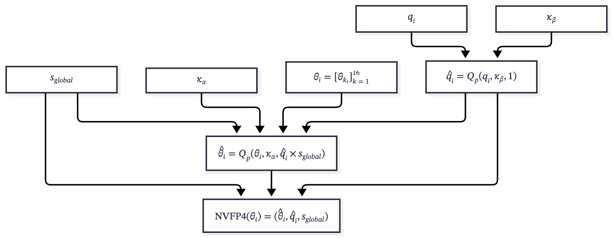
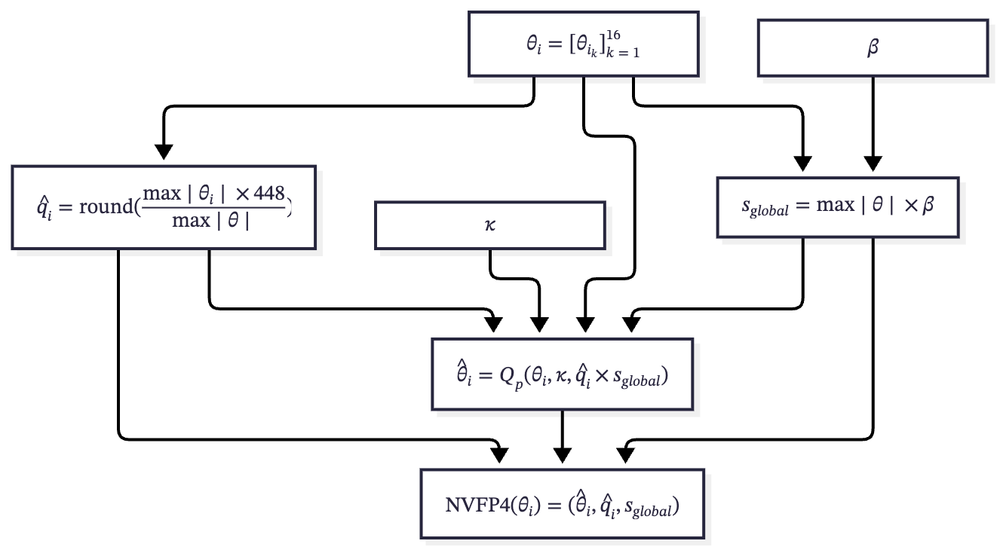

# The Big Picture

[Coded Deep Learning: Framework and Algorithm](https://arxiv.org/abs/2501.09849) - C2

## Family of Formats

`✓` supported · `△` emulated by another datapath · `✗` not supported

|                          | INT8 | INT4 | FP8 | MXFP8 | FP4 | MXFP4 | NVFP4 |
| ------------------------ | :--: | :--: | :-: | :---: | :-: | :---: | :---: |
| SM89                     |  ✓   |  ✓   |  ✓  |   ✗   |  ✗  |   ✗   |   ✗   |
| SM100                    |  ✓   |  △   |  ✓  |   ✓   |  ✓  |   ✓   |   ✓   |
| SM120                    |  ✓   |  △   |  ✓  |   ✓   |  ✓  |   ✓   |   ✓   |
| Block Scaler (Hardware)  |  ✗   |  ✗   |  ✗  |   ✓   |  ✗  |   ✓   |   ✓   |
| Global Scaler (Software) |  ✓   |  ✓   |  ✓  |   ✗   |  ✓  |   ✗   |   ✓   |

Examples of acceleration cards for each architecture:

- **SM89** (Ada): RTX 4070 Super, RTX 6000 Ada, L40S, L4
- **SM100/103** (Blackwell): B200, B300, GB200, GB300
- **SM120/121** (Blackwell): RTX 5070 Ti, RTX Pro 6000 Blackwell, DGX Spark

## Quantization Reasons

|           | Weight                                                                                          | Activation                                                                                          | KV-Cache                                                                                           |
| --------- | ----------------------------------------------------------------------------------------------- | --------------------------------------------------------------------------------------------------- | -------------------------------------------------------------------------------------------------- |
| Bandwidth | 🔥🔥🔥 Reduces weight-loading bandwidth, the bottleneck in small-batch decoding.                | 🔥 Reduces activation read/write bandwidth; mainly matters for large batches or prefill.            | 🔥🔥 Reduces KV-cache read bandwidth, the bottleneck in long-context decoding.                     |
| GEMM      | 🔥🔥 Easy to quantize, but it does not speed up GEMM unless activations are also low precision. | 🔥🔥🔥 Harder to quantize, but combining it with weight quantization unlocks the full GEMM speedup. | 🔥 Low-precision attention kernels are uncommon, and attention is usually sensitive to precision.  |
| Memory    | 🔥🔥🔥 Smaller model footprint for storage and loading.                                         | 🔥 Minor for inference; matters for training, where activations are kept for backward.              | 🔥🔥🔥 Grows $`O(n)`$ with context length, so quantization saves a lot for long-context inference. |

## Challenges

BS stands for block scaler for NVFP4.

- Linear: `N` for batch size, `K` for input features, `M` for output features.
- KV Cache: `B` for batch size, `H` for number of heads, `T` for sequence length, `D` for head dimension.

| Type       | Tensor         | Expected BS       | Batch-independent BS | Learnable BS Counts |
| ---------- | -------------- | ----------------- | -------------------- | ------------------- |
| Activation | `[N, K]`       | `[N, K/16]`       | `[1, K/16]`          | `K/16`              |
| Weight     | `[M, K]`       | `[M, K/16]`       | `[M, K/16]`          | `M*K/16`            |
| KV Cache   | `[B, H, T, D]` | `[B, H, T, D/16]` | `[1, H, 1, D/16]`    | `H*D/16`            |

In other words, static quantization block scalers only work perfectly on weights. For activations, all samples must share the same block scalers, whereas dynamically computed scalers have no such restrictions.

## Case Studies

Both papers apply quantization during post-training rather than pre-training, but with different emphases: DeepSeek uses QAT on the KV cache for storage compression without touching weights, while Kimi uses QAT on expert weights to reduce serving cost and keeps the cache untouched.

### DeepSeek-V4.1-Flash

The quantization focus is on KV caches.

| Tensor           | Format                                            | Notes                                                                     |
| ---------------- | ------------------------------------------------- | ------------------------------------------------------------------------- |
| Main (global) KV | FP4 (E2M1 + one E4M3 scale per 16 channels)       | NVFP4 layout without the second-level global scale; quantized after RoPE. |
| SWA KV           | FP8                                               | Kept at higher precision due to quantization sensitivity.                 |
| Indexer Q/K      | FP4 (inherited from DeepSeek-V4)                  | Via QAT.                                                                  |
| Weights          | BF16                                              | Backbone weights not quantized.                                           |
| Activations      | BF16 (FP8 for Engram embeddings & KV projections) | KV quantization targets storage, not GEMM.                                |

Some other noteworthy details:

- The global scale is deliberately omitted: E2M1×E4M3 spans up to $`448 \times 6 = 2688`$, while post-RoPE KV values stay below $`\sqrt{512} \approx 22.6`$, so a tensor scale is provably unnecessary.
- KV caches are dequantized before CSA2, so no native FP4 attention kernel is required.

### Kimi K3

The quantization focus is on reducing model size and speeding up GEMM.

| Tensor                    | Format | Notes                                                                   |
| ------------------------- | ------ | ----------------------------------------------------------------------- |
| Routed expert weights     | MXFP4  | Expert weights dominate parameter memory.                               |
| Expert activations        | MXFP8  | Unlocks the full GEMM speedup for expert layers.                        |
| Other weights/activations | BF16   | Attention projections, latent MoE projections, shared experts, routers. |

## Preliminary Results

All results are on SmolLM2-135M. Activations are dynamically quantized and approximated using a straight-through estimator (STE). Weights are quantized using STE, Cascaded CDL, or Extended CDL. The target modules are all linear layers except for the final output head, and their matrix multiplications are performed using NVFP4 kernels. The entire base model is frozen.

- **Dataset**: 100k documents sampled from the final-stage pre-training corpus of SmolLM2
- **LoRA**: $`r=16`$ and $`\alpha=32`$
- **LR Scheduler**: constant with a 200/1500-step warmup
- **Optimizers**: SGD ($`\eta=0.1`$, $`\mu=0.9`$) for the quantizers and AdamW ($`\eta=10^{-4}`$) for the rest
- **Batch**: batch size of 16 with a sequence length of 1024
- **CDL**: `amax` instead of `mean` for scaler initialization, and $`\kappa=64`$

Note: the variants with a `AdamW` tag train the quantizer parameters with a single AdamW LR of $`3\times10^{-4}`$ instead.

### Zero-shot Commonsense Accuracy

Accuracies are length-normalized for HellaSwag, ARC, and OBQA.

| Weight Quantization Variant    | $`\uparrow`$ BoolQ | $`\uparrow`$ PIQA | $`\uparrow`$ SIQA | $`\uparrow`$ HS | $`\uparrow`$ WG | $`\uparrow`$ ARC-e | $`\uparrow`$ ARC-c | $`\uparrow`$ OBQA |
| ------------------------------ | -----------------: | ----------------: | ----------------: | --------------: | --------------: | -----------------: | -----------------: | ----------------: |
| **None (BF16 Base)**           |           **60.6** |          **68.3** |          **38.5** |        **41.9** |        **51.8** |           **59.3** |           **29.3** |          **32.0** |
| STE with LoRA                  |               54.6 |              64.2 |              37.2 |            39.8 |            51.8 |               53.7 |               27.7 |              30.0 |
| Cascaded CDL scalers only      |               51.4 |              62.8 |              36.6 |            39.8 |            49.8 |               54.1 |               26.8 |              31.2 |
| Cascaded CDL + LoRA            |           **57.4** |              63.7 |              37.2 |        **40.2** |        **52.1** |               54.6 |               27.9 |              30.8 |
| Cascaded CDL + LoRA, AdamW     |               56.3 |              64.0 |              37.3 |            40.0 |            49.7 |               54.1 |               27.6 |              30.4 |
| Extended CDL scalers only      |               53.2 |              63.1 |              37.8 |            39.3 |            51.0 |               53.8 |               27.9 |              28.8 |
| Extended CDL + LoRA            |               53.9 |          **65.2** |          **38.1** |            39.7 |            50.2 |               55.1 |               27.9 |              30.2 |
| **Extended CDL + LoRA, AdamW** |               56.4 |              64.2 |              36.6 |            40.1 |            51.9 |           **55.3** |           **28.2** |          **31.8** |

### Overall Performance

We report WikiText-2/C4 perplexity, average zero-shot commonsense accuracy, and the number of trainable parameters.

| Weight Quantization Variant    | $`\downarrow`$ Wiki2 | $`\downarrow`$ C4 | $`\uparrow`$ Commonsense | Parameters |
| ------------------------------ | -------------------: | ----------------: | -----------------------: | ---------: |
| **None (BF16 Base)**           |            **15.43** |         **21.62** |                **47.69** |          0 |
| STE with LoRA                  |                19.57 |             26.21 |                    44.86 |     4.884M |
| Cascaded CDL scalers only      |                20.80 |             28.12 |                    44.06 |     6.636M |
| Cascaded CDL + LoRA            |                19.21 |             25.77 |                    45.49 |    11.520M |
| Cascaded CDL + LoRA, AdamW     |                19.18 |         **25.75** |                    44.94 |    11.520M |
| Extended CDL scalers only      |                21.33 |             29.03 |                    44.35 |        210 |
| Extended CDL + LoRA            |                19.25 |             25.84 |                    45.03 |     4.885M |
| **Extended CDL + LoRA, AdamW** |            **19.17** |             25.82 |                **45.58** |     4.885M |

## Design Choices

### Cascaded CDL

Two main challenges: too many trainable parameters and an inability to handle activations.



### Extended CDL

A simpler design in which only the tensor scale is learnable.



To compute the block scale dynamically:

```math
q_i = \frac{\max \lvert \theta_i \rvert \times 448}{\max \lvert \theta \rvert} = \frac{\max \lvert \theta_i \rvert}{6} \div \frac{\max \lvert \theta \rvert}{6 \times 448}
```

where $`\max_{q \in \mathcal{F}_{\mathrm{E2M1}}} \lvert q \rvert = 6`$ and $`\max_{q \in \mathcal{F}_{\mathrm{E4M3}}} \lvert q \rvert = 448`$.

Note: The $`round`$ operation can be replaced by stochastic rounding $`SR`$ or probabilistic quantization $`Q_p`$. No gradients pass through this part.
