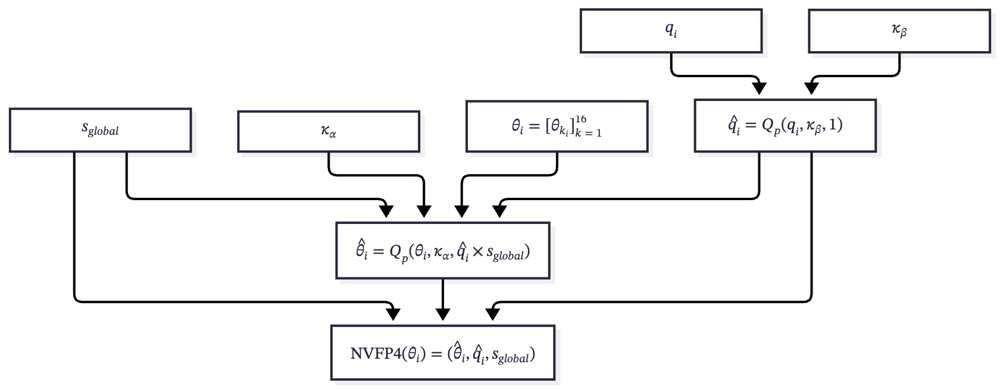
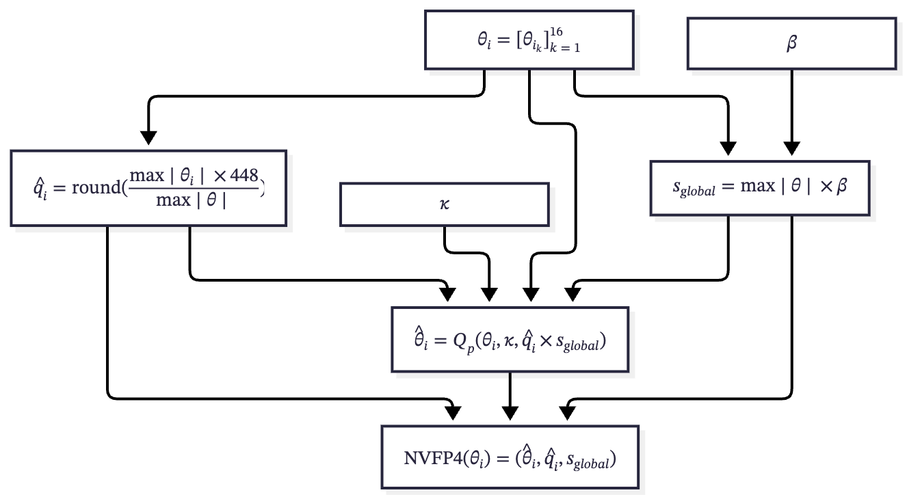

# The Big Picture

[Coded Deep Learning: Framework and Algorithm](https://arxiv.org/abs/2501.09849) - C2

---

## Family of Formats

There are many formats supported by hardware, but we primarily focus on the FP8 and FP4 series on NVIDIA platforms.

---

### Architecture Requirement

|       | FP8 | MXFP8 | FP4 | MXFP4 | NVFP4 |
| ----- | :-: | :---: | :-: | :---: | :---: |
| SM89  |  ✓  |   ✗   |  ✗  |   ✗   |   ✗   |
| SM100 |  ✓  |   ✓   |  ✓  |   ✓   |   ✓   |
| SM120 |  ✓  |   ✓   |  ✓  |   ✓   |   ✓   |

Examples of acceleration cards for each architecture:

- **SM89** (Ada): RTX 4070 Super, RTX 6000 Ada, L40S, L4
- **SM100/103** (Blackwell DC): B200, B300, GB200, GB300
- **SM120/121** (Blackwell WS): RTX 5070 Ti, RTX Pro 6000 Blackwell, DGX Spark

---

### Format Specification

`-` not part of the specification, but can always be emulated by software

|              |    FP8    |   MXFP8   | FP4  | MXFP4 | NVFP4 |
| ------------ | :-------: | :-------: | :--: | :---: | :---: |
| Element      | E4M3/E5M2 | E4M3/E5M2 | E2M1 | E2M1  | E2M1  |
| Block Scale  |     -     |   E8M0    |  -   | E8M0  | E4M3  |
| Global Scale |     -     |     -     |  -   |   -   | FP32  |

---

## Quantization Target Definitions

**Weight**: model parameters

**Activation**: all tensors that are dynamically computed; here, the term refers specifically to the tensors that feed into `Linear` layers, where they are matrix-multiplied with the corresponding weights

**KV-Cache**: a subset of the generic activations defined above, namely the activations that feed into attention kernels

---

## Quantization Reasons

|           | Weight                                                 | Activation                                                      | KV-Cache                                                                  |
| --------- | ------------------------------------------------------ | --------------------------------------------------------------- | ------------------------------------------------------------------------- |
| Bandwidth | 🔥🔥🔥 Weight read bandwidth for small-batch decoding. | 🔥 Activation read/write bandwidth for large batches or prefill | 🔥🔥 KV-cache read bandwidth for long-context decoding                    |
| GEMM      | 🔥🔥 Easy to quantize, but it does no direct speed up  | 🔥🔥🔥 Hard to quantize, but unlock full speedup                | 🔥 Low-precision attention kernels are uncommon                           |
| Memory    | 🔥🔥🔥 Smaller model footprint for storage and loading | 🔥 Activations are kept for backward during training            | 🔥🔥🔥 Proportional to context length, critical to long-context inference |

---

## Case Studies

DeepSeek-V4.1-Flash and Kimi K3 are two open source large language models.

Both papers apply quantization during post-training rather than pre-training, but with different emphases: DeepSeek uses QAT on the KV-Cache for storage compression without touching weights, while Kimi uses QAT on expert weights to reduce serving cost and keeps the cache untouched.

---

### DeepSeek-V4.1-Flash

The quantization focus is on KV-Caches.

| Tensor           | Format | Notes                                                    |
| ---------------- | ------ | -------------------------------------------------------- |
| Main (global) KV | NVFP4  | NVFP4 layout without the second-level global scale       |
| SWA KV           | FP8    | Kept at higher precision due to quantization sensitivity |
| Indexer Q/K      | FP4    | Via QAT                                                  |
| Weights          | BF16   | Backbone weights not quantized                           |
| Activations      | BF16   | FP8 for Engram embeddings & KV projections               |

---

Some other noteworthy details:

- The global scale is deliberately omitted: E2M1×E4M3 spans up to $448 \times 6 = 2688$, while post-RoPE KV values stay below $\sqrt{512} \approx 22.6$, so a tensor scale is provably unnecessary.
- KV-Caches are dequantized before CSA2, so no native FP4 attention kernel is required.

---

### Kimi K3

The quantization focus is on reducing model size and speeding up GEMM.

| Tensor                | Format | Notes                                                                   |
| --------------------- | ------ | ----------------------------------------------------------------------- |
| Routed expert weights | MXFP4  | Expert weights dominate parameter memory.                               |
| Expert activations    | MXFP8  | Unlocks the full GEMM speedup for expert layers.                        |
| Others                | BF16   | Attention projections, latent MoE projections, shared experts, routers. |

---

## Design Choices

Introducing Extended CDL — another variant besides Cascaded CDL.

---

### Cascaded CDL

Both block scale and global scale are trainable.

---

## 

---

### Extended CDL

A simpler design in which only the global scale is learnable.

---

---

To compute the block scale dynamically:

$q_i = \frac{\max \lvert \theta_i \rvert \times 448}{\max \lvert \theta \rvert} = \frac{\max \lvert \theta_i \rvert}{6} \div \frac{\max \lvert \theta \rvert}{6 \times 448}$

where $\max_{q \in \mathcal{F}_{\mathrm{E2M1}}} \lvert q \rvert = 6$ and $\max_{q \in \mathcal{F}_{\mathrm{E4M3}}} \lvert q \rvert = 448$.

Note: The $\mathrm{round}$ operation can be replaced by stochastic rounding $\mathrm{SR}$ or probabilistic quantization $Q_p$. No gradients pass through this part.

---

## Challenges

BS stands for block scale for NVFP4.

- Linear: `N` for batch size, `K` for input features, `M` for output features.
- KV-Cache: `B` for batch size, `H` for number of heads, `T` for sequence length, `D` for head dimension.

| Type       | Tensor         | Expected BS       | Batch-independent BS | Counts   |
| ---------- | -------------- | ----------------- | -------------------- | -------- |
| Activation | `[N, K]`       | `[N, K/16]`       | `[1, K/16]`          | `K/16`   |
| Weight     | `[M, K]`       | `[M, K/16]`       | `[M, K/16]`          | `M*K/16` |
| KV-Cache   | `[B, H, T, D]` | `[B, H, T, D/16]` | `[1, H, 1, D/16]`    | `H*D/16` |

---

In other words, statically quantized block scales only work perfectly on weights. For activations, all samples must share the same block scale, whereas dynamically computed scales have no such restriction.

---

## CDL for Block Scaled Format

`✓` supported · `△` limited support · `✗` not supported

|            | CDL | Cascaded CDL | Extended CDL |
| ---------- | :-: | :----------: | :----------: |
| Weight     |  ✗  |      ✓       |      ✓       |
| Activation |  ✗  |      △       |      ✓       |
| KV-Cache   |  ✗  |      △       |      ✓       |

Note: vanilla CDL supports global scale directly, so it is not part of the discussion.

---

## Preliminary Results

All results are on SmolLM2-135M. Activations are dynamically quantized and approximated using a straight-through estimator (STE). Weights are quantized using STE, Cascaded CDL, or Extended CDL. The target modules are all linear layers except for the final output head, and their matrix multiplications are performed using NVFP4 kernels. The entire base model is frozen.

---

### Hyper-parameters

- **Dataset**: 100k docs sampled from the final-stage pre-training corpus of SmolLM2
- **LoRA**: $r=16$ and $\alpha=32$
- **LR Scheduler**: constant with a 200/1500-step warmup
- **Optimizers**: SGD ($\eta=0.1$, $\mu=0.9$) for the quantizers and AdamW ($\eta=10^{-4}$) for the rest
- **Batch**: batch size of 16 with a sequence length of 1024, trained 1500 iterations
- **CDL**: `amax` instead of `mean` for scale initialization, and $\kappa=64$

Note: the variants with an `AdamW` tag train the quantizer parameters with a single AdamW LR of $3\times10^{-4}$ instead.

---

### Zero-shot Commonsense Accuracy w/ LoRA

Accuracies are length-normalized for HellaSwag, ARC, and OBQA.

| Weight Variant       |    BoolQ |     PIQA |     SIQA |       HS |       WG |     ARCe |     ARCc |     OBQA |
| -------------------- | -------: | -------: | -------: | -------: | -------: | -------: | -------: | -------: |
| **None (BF16 Base)** | **60.6** | **68.3** | **38.5** | **41.9** | **51.8** | **59.3** | **29.3** | **32.0** |
| STE                  |     54.6 |     64.2 |     37.2 |     39.8 |     51.8 |     53.7 |     27.7 |     30.0 |
| Cascaded CDL         | **57.4** |     63.7 |     37.2 | **40.2** | **52.1** |     54.6 |     27.9 |     30.8 |
| Cascaded CDL + AdamW |     56.3 |     64.0 | **37.3** |     40.0 |     49.7 |     54.1 |     27.6 |     30.4 |
| Extended CDL         |     53.0 | **65.3** |     37.2 |     40.1 |     51.5 | **55.0** | **28.6** | **31.6** |
| Extended CDL + AdamW |     53.9 |     64.5 |     36.6 |     39.9 |     51.2 |     54.1 |     28.4 |     29.8 |

---

### Overall Performance w/ LoRA

We report WikiText-2/C4 perplexity, average zero-shot commonsense accuracy, and the number of trainable parameters.

| Weight Quantization Variant |     Wiki2 |        C4 | Commonsense | Parameters |
| --------------------------- | --------: | --------: | ----------: | ---------: |
| **None (BF16 Base)**        | **15.43** | **21.62** |   **47.69** |          0 |
| STE                         |     19.57 |     26.21 |       44.86 |     4.884M |
| Cascaded CDL                |     19.21 |     25.77 |   **45.49** |    11.520M |
| Cascaded CDL + AdamW        | **19.18** | **25.75** |       44.94 |    11.520M |
| Extended CDL                |     19.26 |     25.85 |       45.28 |     4.885M |
| Extended CDL + AdamW        |     19.19 |     25.87 |       44.88 |     4.885M |

---

### Quick Conclusion

Both Cascaded CDL and Extended CDL are better than STE, and Extended CDL does not degrade the performance because of less learnable parameters.

**Caveat**: 1500 iterations are not sufficient, but they give a good peek at the direction.

---

### Zero-shot Commonsense Accuracy w/o LoRA

Accuracies are length-normalized for HellaSwag, ARC, and OBQA.

| Weight Quantization Variant |    BoolQ |     PIQA |     SIQA |       HS |       WG |     ARCe |     ARCc |     OBQA |
| --------------------------- | -------: | -------: | -------: | -------: | -------: | -------: | -------: | -------: |
| **None (BF16 Base)**        | **60.6** | **68.3** | **38.5** | **41.9** | **51.8** | **59.3** | **29.3** | **32.0** |
| Cascaded CDL                |     51.4 |     62.8 |     36.6 |     39.8 |     49.8 |     54.1 |     26.8 |     31.2 |
| Extended CDL                |     52.6 |     62.2 |     36.2 |     39.1 |     51.8 |     55.1 |     26.7 |     30.2 |

---

### Overall Performance w/o LoRA

We report WikiText-2/C4 perplexity, average zero-shot commonsense accuracy, and the number of trainable parameters.

| Weight Quantization Variant |     Wiki2 |        C4 | Commonsense | Parameters |
| --------------------------- | --------: | --------: | ----------: | ---------: |
| **None (BF16 Base)**        | **15.43** | **21.62** |   **47.69** |          0 |
| Cascaded CDL                |     20.80 |     28.12 |       44.06 |     6.636M |
| Extended CDL                |     21.51 |     28.97 |       44.24 |        210 |

---

### Quick Conclusion

Adjusting the scales are not enough, so LoRA is important.

---

### Why Are Activations Still Quantized with STE Instead of CDL?

For all CDL variants, $\kappa=2$ is stable but too soft, while $\kappa=16$ is sharp enough, but it leads to gradient explosion. The former is preferred because it at least trains. However, it causes an inconsistency between the soft forward pass during training and the hard nearest rounding during inference. Batch normalization re-estimation was employed to address this problem for ResNet, but it does not work for LLMs.

Possible solution: decouple the hardness factor, e.g., $\kappa_{forward}=16$ and $\kappa_{backward}=2$.

---

## Next Move

Quantize activation and KV-caches, and try larger models.
