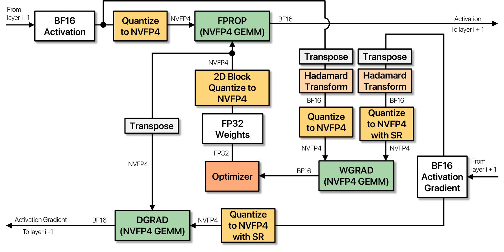

# One Step Forward

[Coded Deep Learning: Framework and Algorithm](https://arxiv.org/abs/2501.09849) - C1 & C2

---

## The Four Bits Era: W4-A4-G4-KV4

Following the official NVFP4 [recipe](https://arxiv.org/abs/2509.25149) from NVIDIA, we additionally apply:

- $\uparrow$ Random Hadamard transforms (RHT) to bound outliers for backward gradients
- $\uparrow$ Stochastic rounding for unbiased gradient estimation
- $\downarrow$ 2D ($16 \times 16$) block scales for weights instead of 1D ($1 \times 16$), unfortunately

_Note: it only stabilizes backward propagation, and is orthogonal to CDL variants._

---

_Figure 5 from [Pretraining Large Language Models with NVFP4](https://arxiv.org/abs/2509.25149) (NVIDIA et al., 2025)._

---

## Experiments

The same fine-tuning tasks as in the last two weeks, except that

- All the KV-caches are quantized, similar to the activations
- The learning rate scheduler is changed from constant to cosine decay
- Full fine-tuning instead LoRA which is more similar to pre-training

Only NVFP4 on SmolLM2-360M is reported for this week unless specified.

---

## Weight Block Scaling

2D means each $16 \times 16$ block shares one scale, versus $1 \times 16$ for 1D. Activation and KV caches are proxied by STE for simplicity. We focus on the weights only.

| Variants | $\downarrow$ Wiki-2 | $\downarrow$ C4 | $\uparrow$ HellaSwag | $\uparrow$ ARC-Easy | $\uparrow$ PIQA |
| -------- | :-----------------: | :-------------: | :------------------: | :-----------------: | :-------------: |
| STE-1D   |        14.13        |      19.49      |        50.99         |        64.31        |      70.08      |
| STE-2D   |        14.61        |      19.91      |        49.75         |        61.20        |      69.31      |
| ECDL-1D  |        14.05        |      19.51      |        50.11         |        61.32        |      69.59      |
| ECDL-2D  |        14.45        |      19.83      |        50.26         |        61.07        |      70.13      |
| CCDL-1D  |        14.02        |      19.42      |        50.47         |        62.37        |      69.91      |
| CCDL-2D  |        14.26        |      19.75      |        49.76         |        61.07        |      70.18      |

---

## NVFP4 Backward Ablation

Same but gradients are in NVFP4. Acitvation and KV caches are proxied by STE for simplicity. We report the test perplexity every 500 iterations.

| Step     |  500  | 1000  | 1500  | 2000  | 2500  | 3000  | 3500  | 4000  |
| -------- | :---: | :---: | :---: | :---: | :---: | :---: | :---: | :---: |
| STE-G16  | 15.93 | 15.84 | 15.72 | 15.57 | 15.47 | 15.26 | 15.10 | 15.04 |
| STE-G4   | 15.93 | 15.87 | 15.76 | 15.58 | 15.41 | 15.25 | 15.16 | 15.11 |
| ECDL-G16 | 16.01 | 15.79 | 15.71 | 15.48 | 15.34 | 15.21 | 15.08 | 15.01 |
| ECDL-G4  | 15.97 | 15.83 | 15.75 | 15.56 | 15.38 | 15.26 | 15.12 | 15.01 |
| CCDL-G16 | 15.87 | 15.75 | 15.62 | 15.44 | 15.15 | 15.09 | 14.94 | 14.95 |
| CCDL-G4  | 15.86 | 15.77 | 15.57 | 15.48 | 15.39 | 15.19 | 15.09 | 15.01 |

---

## Short Conlusion

The full-stack NVFP4 recipe seems to work fine for all. Then we shall make decisions.

---

## Deisgn Choices

Weights, activations, KV caches, and gradients are all in NVFP4 (trained with pure forward KL distillation).

| Variants (W-A) | $\downarrow$ Wiki-2 | $\downarrow$ C4 | $\uparrow$ HellaSwag | $\uparrow$ ARC-Easy | $\uparrow$ PIQA |
| -------------- | :-----------------: | :-------------: | :------------------: | :-----------------: | :-------------: |
| STE-STE        |        14.02        |      19.61      |        50.09         |        62.84        |      69.75      |
| STE-ECDL       |        13.92        |      19.55      |        49.88         |        64.73        |      69.86      |
| ECDL-STE       |        13.92        |      19.53      |        50.04         |        63.76        |      69.48      |
| ECDL-ECDL      |        13.85        |      19.48      |        50.48         |        64.98        |      70.46      |
| CCDL-STE       |        13.82        |      19.56      |        50.14         |        65.53        |      70.18      |
| CCDL-ECDL      |        13.82        |      19.43      |        50.29         |        64.81        |      70.24      |

---

## Progressive Quantization

Ordered from easiest to hardest, at the finest possible granularity (trained with pure forward KL distillation).

| Variants            | $\downarrow$ Wiki-2 | $\downarrow$ C4 | $\uparrow$ HellaSwag | $\uparrow$ ARC-Easy | $\uparrow$ PIQA |
| ------------------- | :-----------------: | :-------------: | :------------------: | :-----------------: | :-------------: |
| W16-A16-G16-KV16    |        11.47        |      16.98      |        54.47         |        69.49        |      71.82      |
| W4(1D)-A16-G16-KV16 |        12.07        |      17.66      |        53.05         |        67.42        |      72.14      |
| W4(1D)-A4-G16-KV16  |        13.07        |      18.75      |        51.26         |        64.81        |      71.06      |
| W4(1D)-A4-G16-KV4   |        13.45        |      19.15      |        50.91         |        64.23        |      70.62      |
| W4(2D)-A4-G4-KV4    |        13.82        |      19.56      |        50.14         |        65.53        |      70.18      |

---

## Caveat

We cannot conclude much things at the moment. Pre-training is more sensitive to the accumulated error during training, but also has more flexibility adjust the weights.
