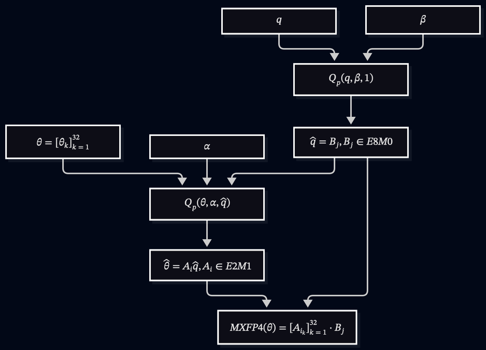

# Hardware Accelerated CDL

[Coded Deep Learning: Framework and Algorithm](https://arxiv.org/abs/2501.09849) - C2

## Quantization Walk-through

**Shape**: `[64, 32, 3, 3]`

**MXFP4**: 32 E2M1 floating-point numbers scaled by one E8M0 factor per block.

### Parameters

Reshape the weight `[64, 32, 3, 3]` into `[64, 288]` and pad it to `[64, 288]` (no padding required for this case). Then reshape it into `[64, 9, 32]`, where `64` is the output feature dimension and `32` is the block size. This implies `[64, 9, 1]` scalers.

Thus, the trainable parameters are:

- Weight: `[64, 9, 32]` stored in FP32, targeting FP4 E2M1
- Scaler: `[64, 9, 1]` stored in FP32, targeting FP8 E8M0

Todo: decide whether the sharpness factor should be block-wise or tensor-wise.

### Forward Pass



For readability, the code below does not show the backward proxy and entropy computation. It is functionally correct but unoptimized.

```python
import torch
from torch.distributions import Categorical

MAPPING = torch.tensor([15, 14, 13, 12, 11, 10, 9, 8, 0, 1, 2, 3, 4, 5, 6, 7], dtype=torch.uint8)
E8M0 = torch.pow(2.0, torch.arange(256, dtype=torch.float32) - 127.0)
E2M1 = torch.tensor([-6.0, -4.0, -3.0, -2.0, -1.5, -1.0, -0.5, -0.0, 0.0, 0.5, 1.0, 1.5, 2.0, 3.0, 4.0, 6.0])
ONE = torch.ones(())


def pack_e2m1(x: torch.Tensor) -> torch.Tensor:
    codes = MAPPING[x].reshape(x.shape[0], -1)
    return codes[:, 0::2] | (codes[:, 1::2] << 4)


def pack_e8m0(x: torch.Tensor) -> torch.Tensor:
    m, b = x.shape[0], x.shape[1]
    rows = (m + 127) // 128 * 128
    cols = (b + 3) // 4 * 4
    sf = torch.zeros(rows, cols, dtype=torch.uint8)
    sf[:m, :b] = x.reshape(m, b).to(torch.uint8)
    return sf.view(rows // 128, 4, 32, cols // 4, 4).permute(0, 3, 2, 1, 4).reshape(rows, cols)


def cdl_topk_forward(
    theta: torch.Tensor,
    a: torch.Tensor,
    q: torch.Tensor,
    kappa: torch.Tensor,
    topk: int,
) -> torch.Tensor:
    logits = -kappa * ((theta / q).unsqueeze(-1) - a) ** 2
    topk_values, topk_indices = logits.topk(topk)
    pmf = torch.softmax(topk_values, dim=-1)

    with torch.no_grad():
        sub_indices = Categorical(probs=pmf).sample().unsqueeze(-1)
        chosen = topk_indices.gather(dim=-1, index=sub_indices).squeeze(-1)

    return chosen


def mxfp4_cdl_topk_forward(
    theta: torch.Tensor, q: torch.Tensor
) -> tuple[torch.Tensor, torch.Tensor]:
    b_j = cdl_topk_forward(q, E8M0, ONE, ONE, 5)
    a_i = cdl_topk_forward(theta, E2M1, E8M0[b_j], ONE, 5)
    return a_i, b_j
```

```python
from flashinfer import mm_fp4

# [tokens, in_features] = [16, 288]
activation = torch.rand((16, 9, 32))
activation_scaler = torch.rand((16, 9, 1))
a, a_s = mxfp4_cdl_topk_forward(activation, activation_scaler)

# [out_features, in_features] = [64, 288]
weight = torch.rand((64, 9, 32))
weight_scaler = torch.rand((64, 9, 1))
w, w_s = mxfp4_cdl_topk_forward(weight, weight_scaler)

# [16, 288] @ [64, 288].T = [16, 64]
with torch.cuda.device(1):
    out = mm_fp4(
        pack_e2m1(a).cuda(),
        pack_e2m1(w).cuda().T,
        pack_e8m0(a_s).cuda(),
        pack_e8m0(w_s).cuda().T,
        None,
        torch.bfloat16,
        None,
        block_size=32,
        use_nvfp4=False,
        backend="cudnn",
    )
```

### Backward Pass

Gradients are stored in BF16, but we can quantize them and apply MXFP4 GEMM to them and to the saved tensor from the forward pass.

A quantized matrix multiplication (MM) is formulated by:

```math
Y = \hat{X}\hat{W}^T
```

where

```math
\hat{X} = Q_p(X)
```

The backward propagation need to compute GEMM which is the bottleneck. We can either quantize the gradient or apply mix precision GEMM of MXFP4 and BF16.

```math
\frac{\partial L}{\partial \hat{X}} = \frac{\partial L}{\partial Y} \cdot \frac{\partial Y}{\partial \hat{X}} = \underbrace{Q_u(g)}_{MXFP4} \cdot \underbrace{\hat{W}}_{MXFP4}
```

We use the deterministic quantization as proxy.

```math
\frac{\partial L}{\partial X} = \frac{\partial L}{\partial \hat{X}} \cdot \frac{\partial Q_p(X)}{\partial X} \approx \frac{\partial L}{\partial \hat{X}} \cdot \underbrace{{2\alpha Var\{Q_p(X)\}}}_{Proxy}
```

## Other Formats

MXFP8 uses the E4M3 layout for the weights and E8M0 for the scaler, which is the same scaler as in MXFP4.

NVFP4 is a proprietary format designed by Nvidia that has a higher precision than MXFP4. The block size is 16 instead of 32, and the scaler uses the E4M3 layout. Additionally, each tensor has an FP32 global scaler.
